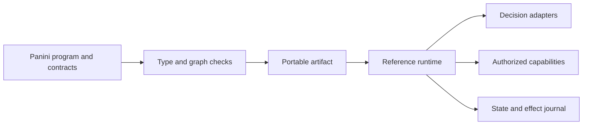

# Panini

Panini is a language for AI agent orchestration: typed state, explicit decisions,
bounded workflow graphs, and controlled access to effectful tools. It separates
what an agent may recommend from what a workflow is permitted to execute.

An agent can classify a request, abstain when confidence is insufficient, or
suggest a next step. Panini makes the surrounding control flow explicit:
which state may change, which transitions are allowed, how retries are bounded,
which capabilities require authorization, and how uncertain effects are resolved.

## Why use a language for agent orchestration?

AI workflows combine probabilistic decisions with operations that need precise
contracts. A refund assistant may recommend approval while the payment service
still requires authorization. An incident agent may retry diagnosis while its
remediation actions need visit limits, receipts and recovery. A coding agent may
produce a result that must pass an invariant before the workflow accepts it.

Panini expresses these boundaries in a program that can be checked before
execution and enforced by a reference runtime:

- **Typed state and decisions:** local schemas, enum-valued decisions, validated
  probability responses, and explicit abstention.
- **Explicit workflow graphs:** normal, error and timeout edges with bounded
  dispatch attempts, reachability checks and cycle diagnostics.
- **Controlled tools:** capability manifests, invocation authorization, typed
  receipts, reconciliation and bounded compensation.
- **Inspectable guarantees:** runtime invariants and ordered policies, with
  optional finite-state invariant analysis under supplied transition contracts.
- **Portable artifacts:** source, contracts and checked intermediate
  representation packaged together for validation by the reference loader.



## Run an example

Python 3.11 or newer is required. From the repository root on Linux or macOS:

```bash
cd panini
python -m venv .venv
.venv/bin/python -m pip install -e '.[dev]'
.venv/bin/panini check examples/decision.panini --adapters examples/decision-adapters.json
.venv/bin/python examples/run_decision.py
.venv/bin/python examples/run_refund.py
```

The decision example routes a confident classification or an abstention. The
refund example demonstrates authorized mock effects, invariant analysis and
compensation after failure. Both use local adapters; no provider account or
payment service is required.

## Language and integration

Panini source describes state, decisions and workflow structure. Python hosts
supply callbacks for ordinary methods, model adapters and external capabilities.
Opaque source method bodies are declarations of contracts, not executable host
code. The current profile is sequential: one active workflow token per run.

Python is the implemented compiler/runtime host. TypeScript is a planned host
integration for web and asynchronous tool workflows; .NET, Java and Go are
planned integration targets for service environments. Generated SDKs, an HTTP
service, native embedding and provider protocols are design directions, not
currently shipped features. See [target languages](docs/targets.md).

## Documentation

Start with the [documentation guide](docs/README.md), or go directly to:

| Guide | Contents |
| --- | --- |
| [Language](docs/language.md) | State, graph control flow, decisions, contracts and diagnostics |
| [Runtime](docs/runtime.md) | Authorization, deadlines, journaling, recovery, policies and finite analysis |
| [Artifacts](docs/artifacts.md) | Build/load contract, schemas, source maps and resource limits |
| [Target languages](docs/targets.md) | Python integration and the cross-language architecture |
| [Development](panini/README.md) | Installation, CLI, Python API, package builds and tests |
| [Evaluation](panini/evaluation/README.md) | Reproducibility, measurements, provenance and open experiments |

Panini does not prove arbitrary host-code termination, temporal liveness, model
accuracy, remote atomicity or successful compensation. A model recommendation
is not authorization. Finite proofs are conditional on explicit model contracts;
reported regression measurements do not establish held-out effectiveness.

Licensed under [Apache-2.0](LICENSE).
